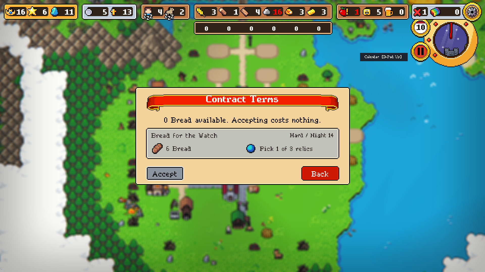
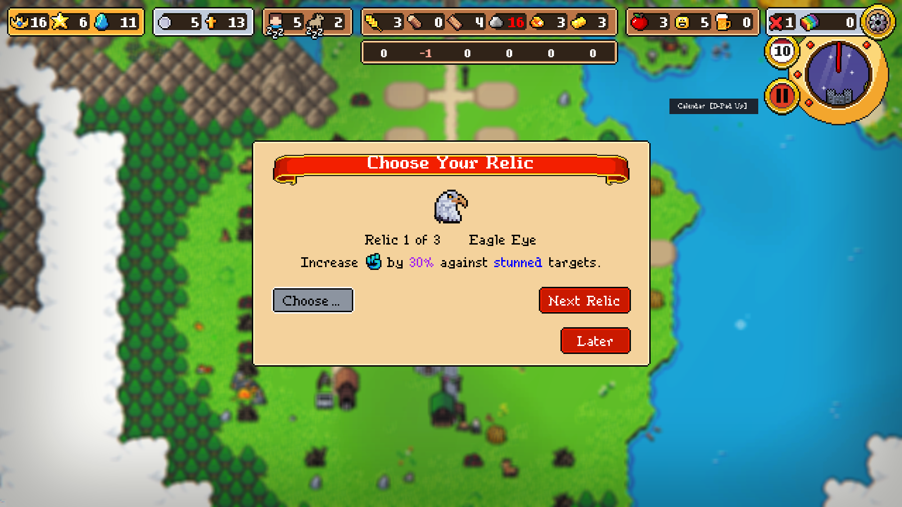

Choose an optional delivery at dawn and finish it before the weekly boss night. Supply jobs pay coins, while **Bread for the Watch** lets you deliver six bread for a choice of three run relics.

## Features

- Compare each offer’s delivery, difficulty, deadline and reward before accepting. Up to two coin-paying jobs rotate through supplies your kingdom can already spend.
- Accept the bread contract even if your shelves are empty. You only pay when you confirm delivery, and missing the deadline costs nothing.
- Keep an earned reward past boss night. Your contract and inventory follow the same kingdom checkpoint when you Continue.

## How to Use

1. At dawn, select an offer to read its terms. Use the **arrow keys** and **Enter**, or the **D-pad** and **bottom face button** (A on an Xbox controller). You can also click a row or button.
2. Select **Accept** to take one job. **Later** lets you reopen the same offers from the calendar for the rest of that morning. **Decline…** asks for confirmation before closing the board for the week.
3. Gather the requested amount before nightfall on the listed day (7, 14, 21 or 28). Open the calendar, select **Contract** beneath the day grid, then select **Deliver**. Review the balance and select **Confirm** to pay.
4. Select **Collect Reward** for your coins or relic cards. For bread, use **Next Relic** to compare effects, then **Choose…** and **Collect** to take one. You can return through the calendar later for an earned reward.

## Screenshots

Captured in-game with Weekly Contracts 0.1.0 at 1.5× UI scale using simulated controller input.

*On day 10, four stone earns three coins. The six-bread offer on the next row has the same night-14 deadline.*

*The stock line shows why you can accept now and deliver later.*

*Eagle Eye is the first of three choices in this run. Browse the others before collecting.*

## Compatibility

Weekly Contracts works on its own and was playtested with all ten GKJ mods. A second playtest included **ownlyme/BakeryUsesWheat 1.2.0**, **ownlyme/TavernFoodPriorities 1.7.0** and **ownlyme/MoreRelics 1.1.0** together. Deliveries use the kingdom’s resource equivalents and leave worker reservations and separate tavern meal inventory intact. Mods with a separate resource store or custom shop-only spending rules may need an integration.

MoreRelics availability and boss-only restrictions apply to relic choices and upgrades. If all three choices become unavailable, you can leave the reward pending or select **Refund** to recover the six units you paid when that resource is available.

## Installation

Select **Install with Mod Manager** on this page and choose your Super Fantasy Kingdom profile. Enable **WeeklyContracts** and its listed dependencies, **BepInExPack 5.4.2305** and **HideManagerGameObject_Config 5.4.2304**, then launch the game modded.
