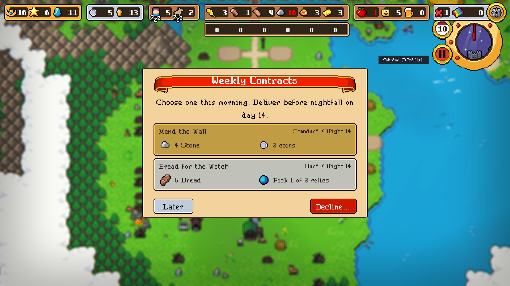
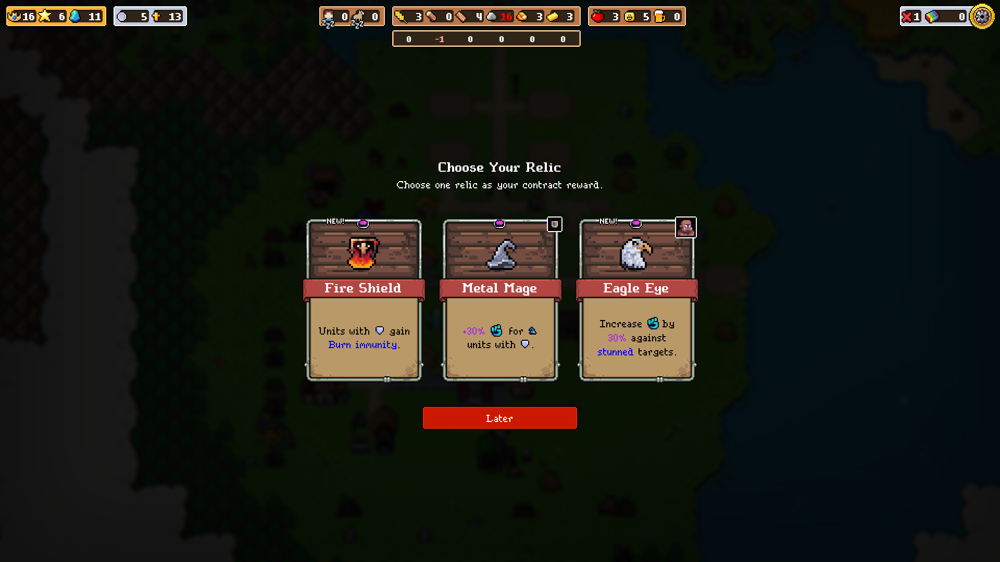
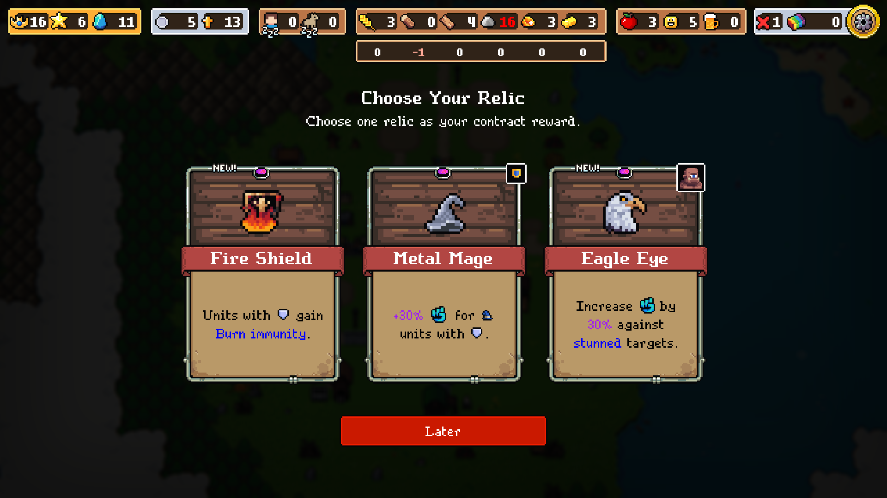

# Weekly Contracts

Choose an optional delivery at dawn and finish it before the weekly boss night. Supply jobs pay coins, while **Bread for the Watch** lets you deliver six bread for a choice of three run relics.

## Features

- Compare each offer’s delivery, difficulty, deadline and reward before accepting. Up to two coin-paying jobs rotate through supplies your kingdom can already spend.
- Accept the bread contract even if your shelves are empty. You only pay when you confirm delivery, and missing the deadline costs nothing.
- Keep an earned reward past boss night. Your contract and inventory follow the same kingdom checkpoint when you Continue.

## How to Use

1. At dawn, select an offer to read its terms. Use the **arrow keys** and **Enter**, or the **D-pad** and **bottom face button** (A on an Xbox controller). You can also click a row or button.
2. Select **Accept** to take one job. **Later** lets you reopen the same offers from the calendar for the rest of that morning. **Decline…** asks for confirmation before closing the board for the week.
3. Gather the requested amount before nightfall on the listed day (7, 14, 21 or 28). Open the calendar, select **Contract** beneath the day grid, then select **Deliver**. Review the balance and select **Confirm** to pay.
4. Select **Collect Reward** for your coins or relic cards. For bread, compare the relic cards side by side. Click a card or move focus with the arrow keys or D-pad, confirm the card, then select **Collect**. You can return through the calendar later for an earned reward.

## Screenshots

The contract picker and terms were captured in 0.1.0 at 1.5× UI scale. The two relic picker views show the same reward in 0.1.1. All captures used simulated controller input.

*On day 10, four stone earns three coins. The six-bread offer on the next row has the same night-14 deadline.*

*The stock line shows why you can accept now and deliver later.*

**1× UI Scale**

*Compare all three effects before selecting a card. Later keeps the same choices available from the calendar.*

**1.5× UI Scale**

*All three cards still fit in one row at the larger scale. Select a card to review it, then choose Collect to claim it.*

## Compatibility

- Weekly Contracts works on its own. In a ten-mod GKJ playtest, the contract button was reachable from [Visitor Calendar](https://thunderstore.io/c/super-fantasy-kingdom/p/GKJ/VisitorCalendar/) using the D-pad, with [Daybook](https://thunderstore.io/c/super-fantasy-kingdom/p/GKJ/Daybook/) and [Amaya Without Cooldown](https://thunderstore.io/c/super-fantasy-kingdom/p/GKJ/AmayaWithoutCooldown/) also enabled.
- A second playtest included [BakeryUsesWheat 1.2.0](https://thunderstore.io/c/super-fantasy-kingdom/p/ownlyme/BakeryUsesWheat/), [TavernFoodPriorities 1.7.0](https://thunderstore.io/c/super-fantasy-kingdom/p/ownlyme/TavernFoodPriorities/) and [MoreRelics 1.1.0](https://thunderstore.io/c/super-fantasy-kingdom/p/ownlyme/MoreRelics/) together. The six-bread delivery charged once and awarded one relic. Relic availability and boss-only restrictions apply to both choices and upgrades.
- Deliveries use your kingdom’s resource equivalents and leave worker reservations and separate tavern meal inventory intact. Mods that use a separate resource store or enforce spending rules only in the shop may need an integration.
- If all three relic choices become unavailable, you can keep the reward pending or select **Refund** to recover the six units you paid once that resource is available.

## Installation

1. Select **Install with Mod Manager** on this page and choose your Super Fantasy Kingdom profile.
2. Enable **WeeklyContracts** and its two listed dependencies, [BepInExPack 5.4.2305](https://thunderstore.io/c/super-fantasy-kingdom/p/BepInEx/BepInExPack/) and [HideManagerGameObject_Config 5.4.2304](https://thunderstore.io/c/super-fantasy-kingdom/p/BepInEx/HideManagerGameObject_Config/).
3. Launch the game modded. At dawn, look for the contract board.
