# Weekly Contracts

Choose an optional delivery at dawn and finish it before the weekly boss night. Supply jobs pay coins, while **Bread for the Watch** lets you deliver six bread for a choice of three run relics.

## Features

- Compare cost, reward, difficulty and deadline on each card. Its stock line shows whether you can deliver now or how much more you need. Up to two coin-paying jobs rotate through supplies your kingdom can already spend.
- Human and Undead orders use their own resource icons over illustrated contract cards. Hover or move focus to see which card or button is active.
- Accept the bread contract even if your shelves are empty. You only pay when you confirm delivery, and missing the deadline costs nothing.
- Keep an earned reward past boss night. Your contract and inventory follow the same kingdom checkpoint when you Continue.

## How to Use

1. At dawn, move left or right to compare cards, then select one to read its terms. Use the **arrow keys** and **Enter**, or the **D-pad** and **bottom face button** (A on an Xbox controller). You can also click a card or button. Move down from a card to reach the footer.
2. Select **Accept** to take one job. **Later** lets you reopen the same offers from the calendar for the rest of that morning. **Decline…** asks for confirmation before closing the board for the week.
3. Gather the requested amount before nightfall on the listed day (7, 14, 21 or 28). Open the calendar, select **Contract** beneath the day grid, then select **Deliver**. Review the before-and-after stock amounts and select **Confirm** to pay. The delivery action appears once the stock is spendable and, for bread, three eligible relics are available.
4. Select **Collect Reward** for your coins or relic cards. For bread, compare the relic cards side by side. Click a card or move focus with the arrow keys or D-pad, confirm the card, then select **Collect**. The gold underline marks the focused relic. **Back** from confirmation restores that card. **Later** keeps the reward available through the calendar.

## Screenshots

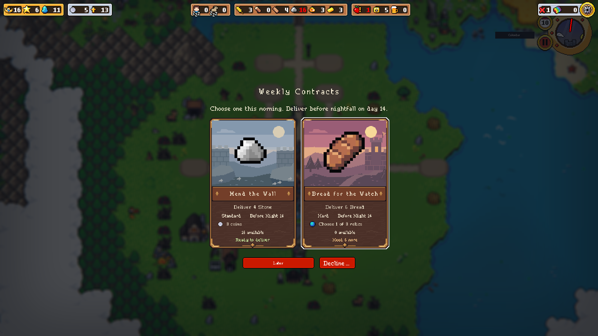

**Human, 1× UI scale.** Compare the delivery cost, deadline, reward and available stock on each offer.

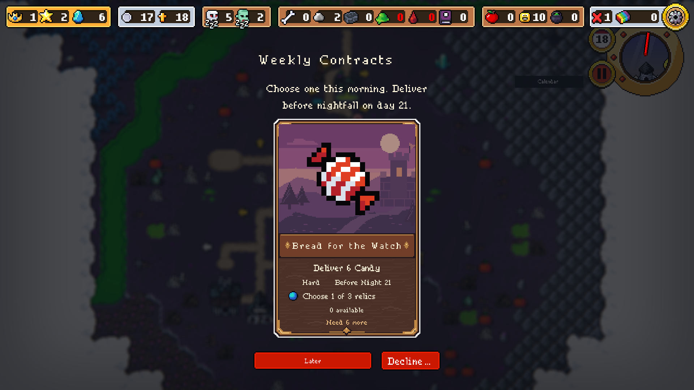

**Undead, 1.5× UI scale.** Bread for the Watch uses Candy in an Undead kingdom.

### Contract Cards

The Human and Undead cards show each kingdom’s delivery material. Stock and deadlines reflect the run shown.

| Contract | Human | Undead |
| --- | --- | --- |
| Bread for the Watch | 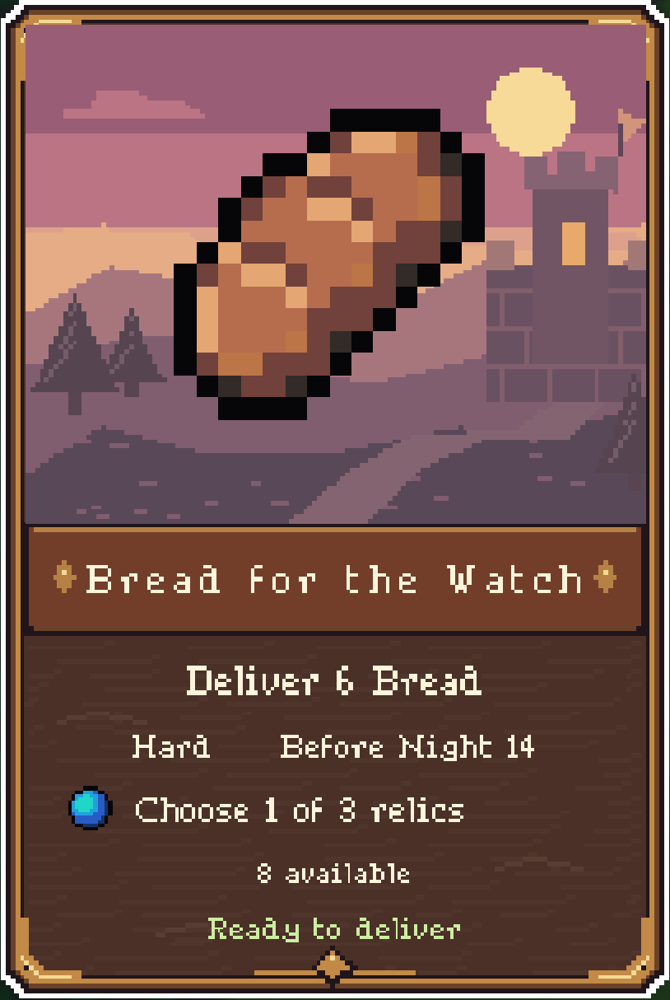 | 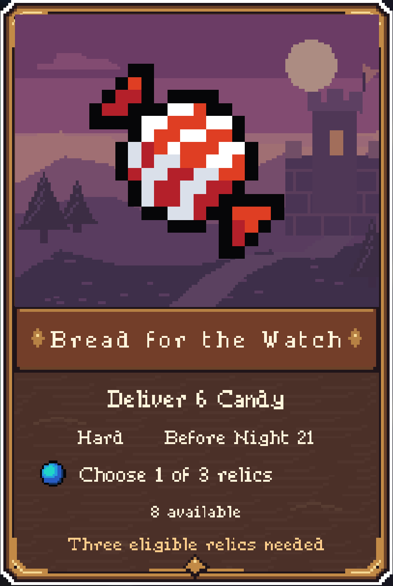 |
| Firewood for Camp | 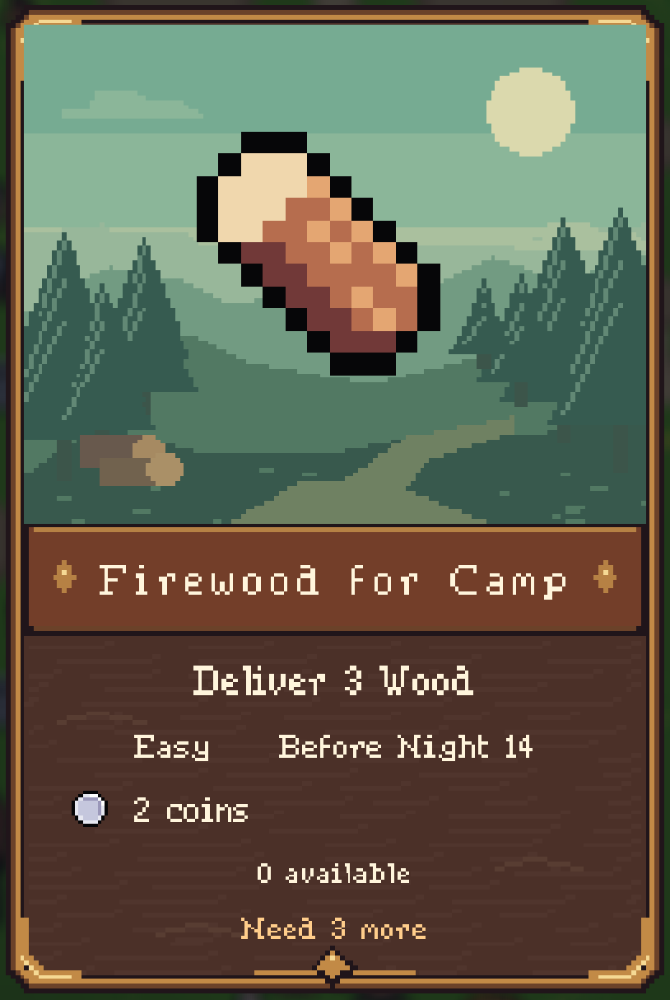 | 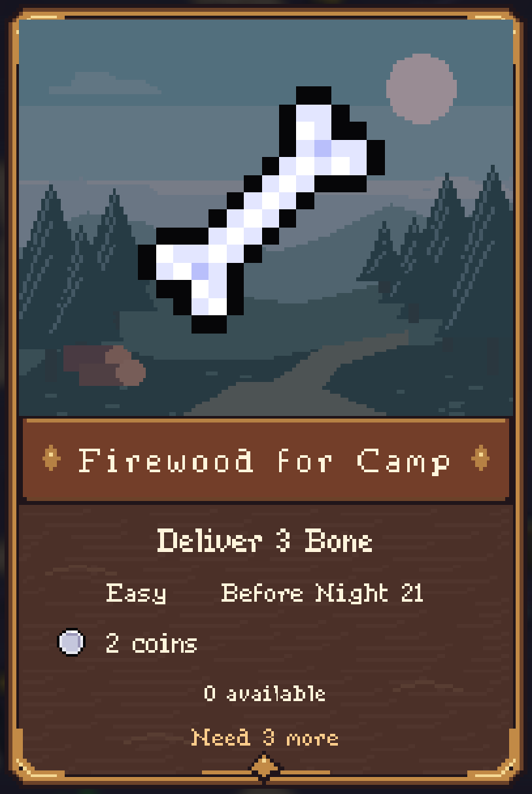 |
| Mend the Wall | 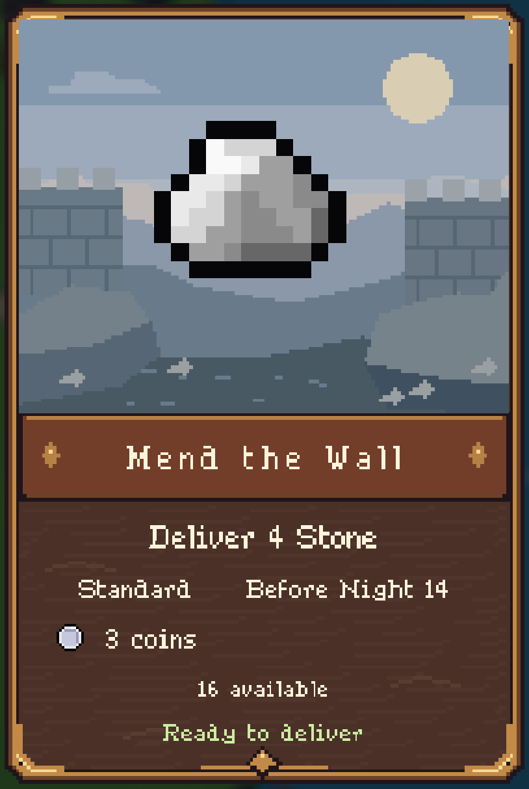 | 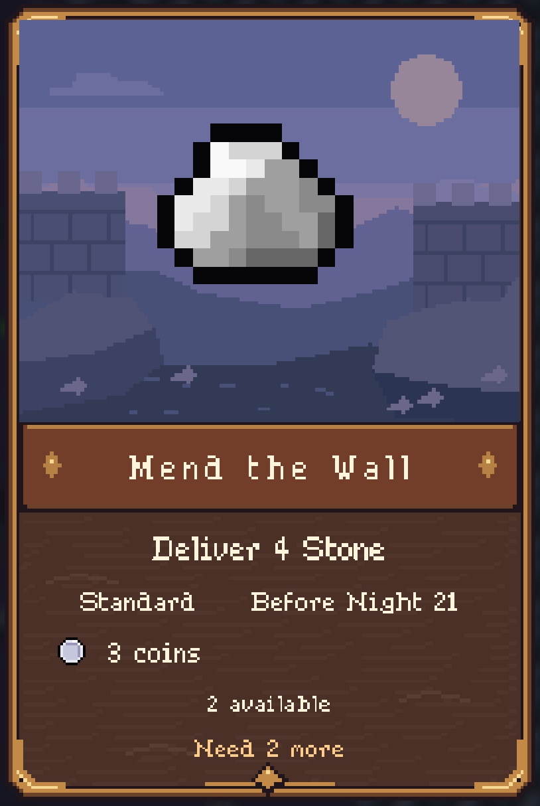 |
| Repair the Bridge | 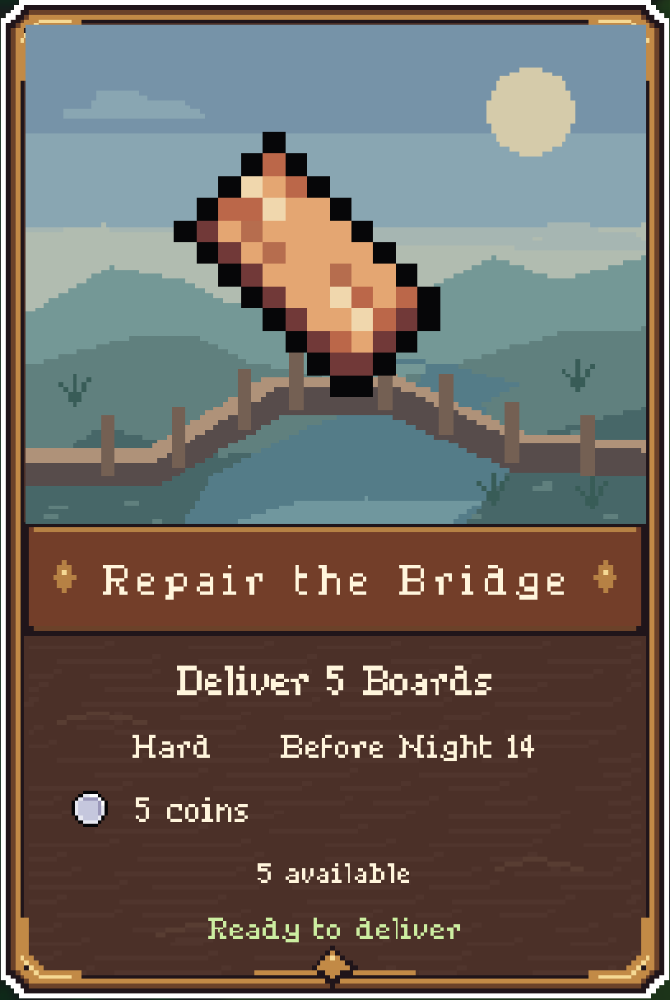 | 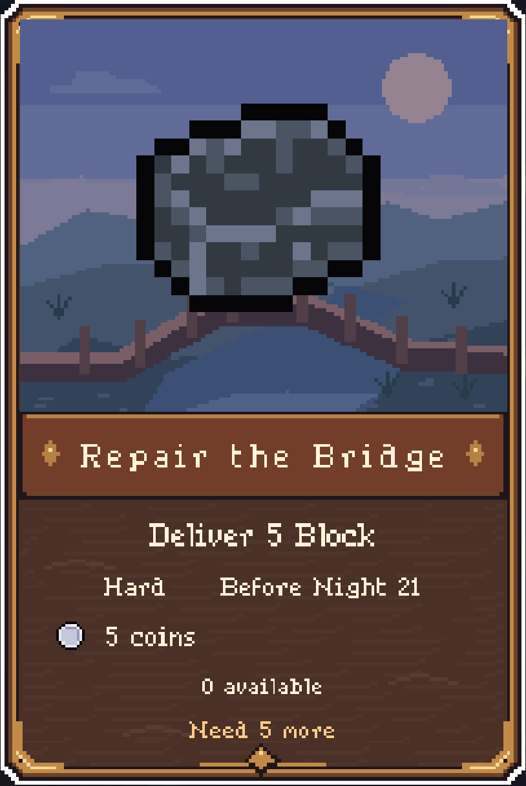 |
| Stock the Granary | 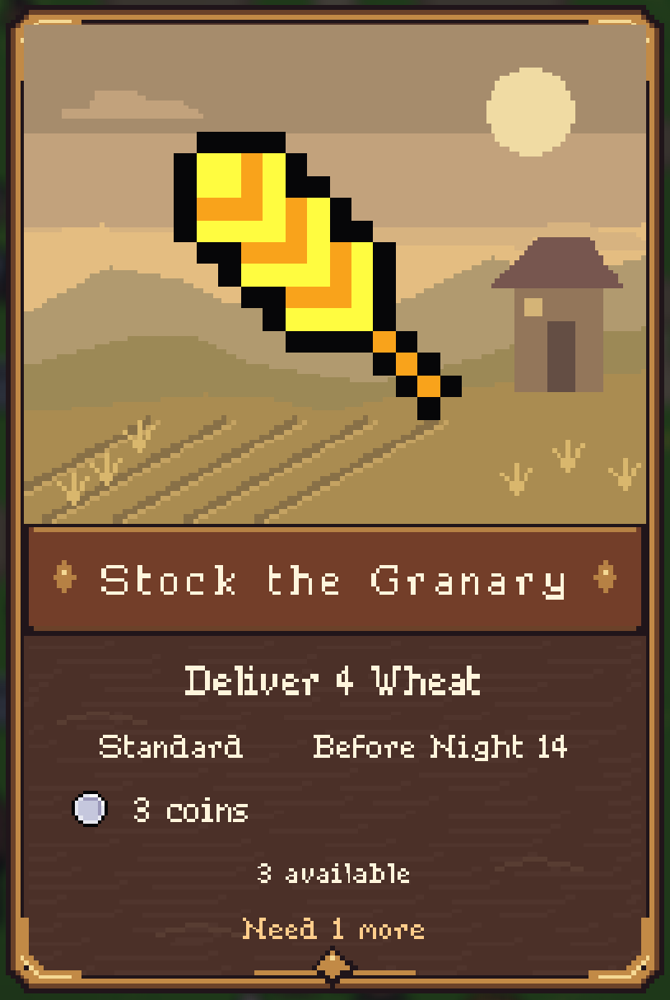 | 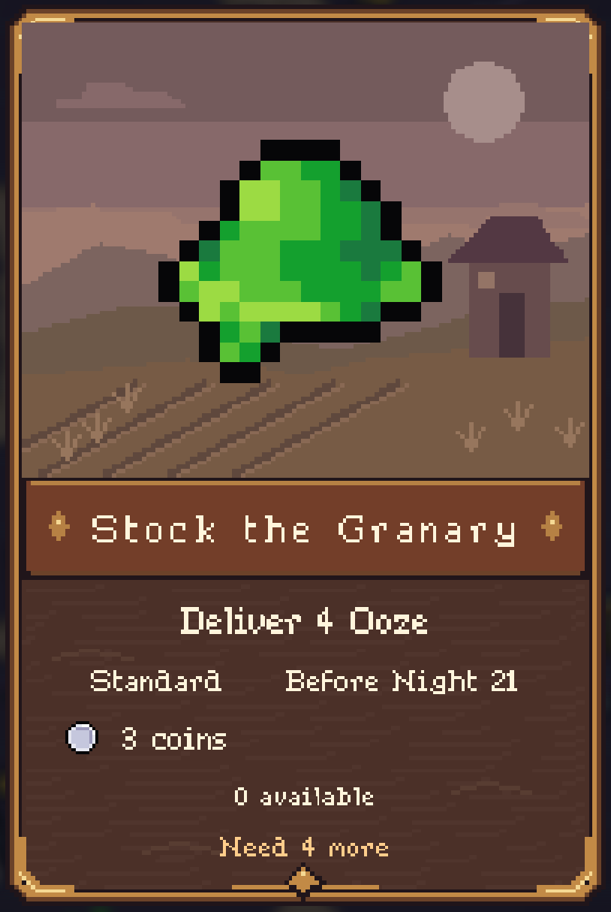 |
| Feed the Scouts | 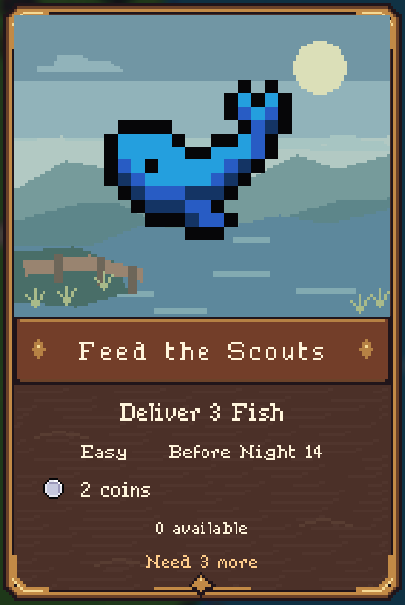 | 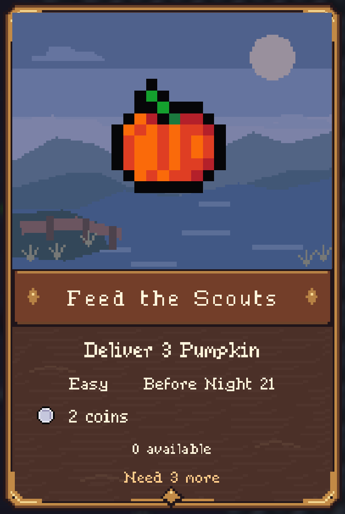 |
| Fill the Canteens | 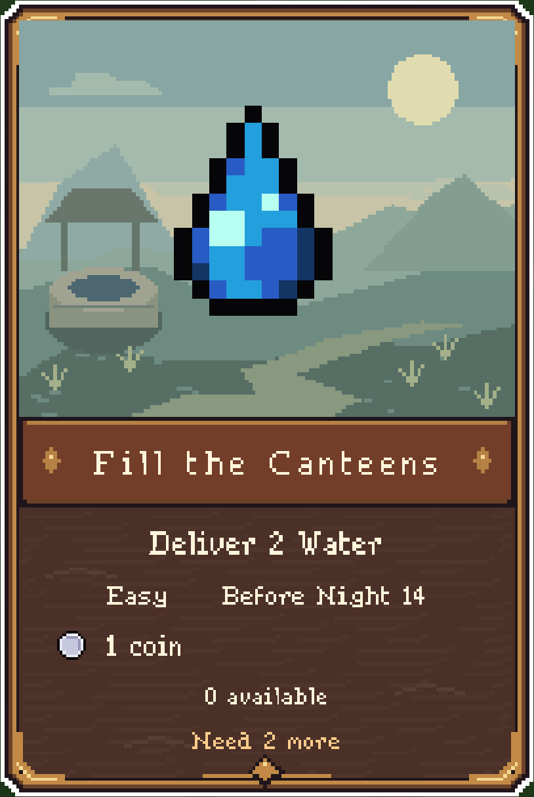 | 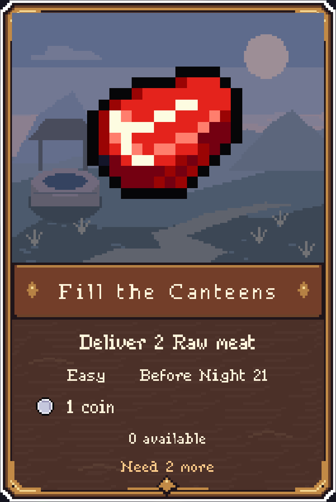 |

## Compatibility

- Tested on Super Fantasy Kingdom **0.8.070** with the [GKJ mod lineup](https://thunderstore.io/c/super-fantasy-kingdom/p/GKJ/).
- [Visitor Calendar](https://thunderstore.io/c/super-fantasy-kingdom/p/GKJ/VisitorCalendar/) 0.1.1 or later can show an accepted order on its deadline. The entry clears on delivery, and the reward can still be collected later.
- Deliveries use your kingdom’s matching resources and keep worker reservations and the tavern’s separate meal stock intact. This works with the recipe changes in [Bakery Uses Wheat](https://thunderstore.io/c/super-fantasy-kingdom/p/ownlyme/BakeryUsesWheat/) and the meal priorities in [Tavern Food Priorities](https://thunderstore.io/c/super-fantasy-kingdom/p/ownlyme/TavernFoodPriorities/).
- Eligible relics from [More Relics](https://thunderstore.io/c/super-fantasy-kingdom/p/ownlyme/MoreRelics/) and [Cursed Relics](https://thunderstore.io/c/super-fantasy-kingdom/p/GKJ/CursedRelics/) can appear in rewards. Availability and boss-only rules still apply. If all three options become unavailable, you can keep the reward pending or request a refund when the resource is available.
- Mods that introduce a separate resource store or enforce spending only in their own shops may need separate support.
- These community mods can share the same profile. [Achievement Enabler](https://thunderstore.io/c/super-fantasy-kingdom/p/ownlyme/AchievementEnabler/), [Bakery Uses Wheat](https://thunderstore.io/c/super-fantasy-kingdom/p/ownlyme/BakeryUsesWheat/), [More Relics](https://thunderstore.io/c/super-fantasy-kingdom/p/ownlyme/MoreRelics/), [Right Click Skip](https://thunderstore.io/c/super-fantasy-kingdom/p/ownlyme/RightClickSkip/), and [Tavern Food Priorities](https://thunderstore.io/c/super-fantasy-kingdom/p/ownlyme/TavernFoodPriorities/).

## Installation

1. Select **Install with Mod Manager** on this page and choose your Super Fantasy Kingdom profile.
2. Enable **WeeklyContracts** and its two listed dependencies, [BepInExPack 5.4.2305](https://thunderstore.io/c/super-fantasy-kingdom/p/BepInEx/BepInExPack/) and [HideManagerGameObject_Config 5.4.2304](https://thunderstore.io/c/super-fantasy-kingdom/p/BepInEx/HideManagerGameObject_Config/).
3. Launch the game modded. At dawn, look for the contract board.

[Support GKJ Games on Ko-fi](https://ko-fi.com/gkj_games)
